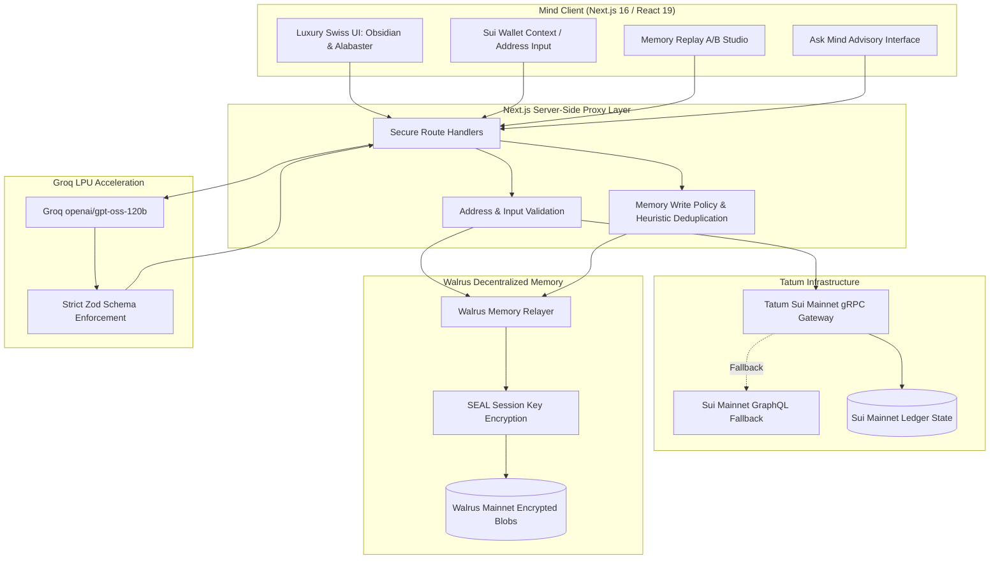

<div align="center">


# MIND

### Autonomous Consumer Financial Intelligence for Sui

**Tatum × Walrus Total Recall Hackathon — Track 03: Consumer Finance Apps**

[](LICENSE)
[](https://nextjs.org/)
[](https://react.dev/)
[](https://www.typescriptlang.org/)
[](https://tatum.io)
[](https://memory.walrus.xyz)
[](https://groq.com)
[](https://mind-hazel.vercel.app)
[](https://mind-production-14a9.up.railway.app)

[Vercel Live](https://mind-hazel.vercel.app) • [Railway Live](https://mind-production-14a9.up.railway.app) • [GitHub Repository](https://github.com/OpeyemiMoses/MIND) • [Judges' Guide](#judges-evaluation-guide-how-to-test-mind) • [Architecture](#system-architecture) • [Quickstart](#quickstart--local-development) • [Memory Replay](#the-signature-differentiator-memory-replay) • [Contributing](CONTRIBUTING.md)

<br/>


</div>

---

## Repository Description

> **Mind is an autonomous consumer financial intelligence agent for Sui. Powered by Tatum Mainnet gRPC (`https://sui-mainnet-grpc.gateway.tatum.io`), Mysten Labs Walrus Memory (`@mysten-incubation/memwal`) with Ed25519 delegate keys & SEAL session encryption, and Groq high-speed LLM reasoning. Mind tracks onchain portfolio balances, remembers user-confirmed financial goals across sessions, and executes Memory Replay (A/B evaluation) proving that remembered context fundamentally elevates financial guidance.**

---

## Judges' Evaluation Guide: How to Test Mind

> **Welcome Hackathon Judges!**
> This walkthrough is designed to help you verify Mind's core integrations and experience the value proposition in **3 to 5 minutes**.
>
> - **Hackathon**: Tatum × Walrus Total Recall Hackathon
> - **Track**: Track 03 — Consumer Finance Apps
> - **Production Deployment (Vercel)**: [mind-hazel.vercel.app](https://mind-hazel.vercel.app)
> - **Production Deployment (Railway)**: [mind-production-14a9.up.railway.app](https://mind-production-14a9.up.railway.app)
> - **Key Innovation**: Demonstrating that decentralized persistent memory on Walrus is not a cosmetic log, but fundamentally alters consumer financial guidance on Sui.

```
  Step 1               Step 2                Step 3              Step 4             Step 5
┌─────────────┐      ┌─────────────┐       ┌─────────────┐     ┌────────────┐     ┌─────────────┐
│ Connect Sui │ ───► │ Live Tatum  │ ────► │ Walrus SEAL │ ──► │ Run Memory │ ──► │ Test Ask    │
│ Wallet      │      │ Mainnet RPC │       │ Timeline    │     │ Replay A/B │     │ Mind AI     │
└─────────────┘      └─────────────┘       └─────────────┘     └────────────┘     └─────────────┘
```

### 1. Step 1: Connect a Sui Wallet
1. Open the application at [mind-hazel.vercel.app](https://mind-hazel.vercel.app) (or [mind-production-14a9.up.railway.app](https://mind-production-14a9.up.railway.app) / locally at `http://localhost:3000`).
2. Click **Get Started** from the landing page.
3. The app automatically scans your browser for active Sui wallet extensions complying with the **Sui Wallet Standard** (e.g. **Slush / Sui Wallet**, **Suiet**, or **Nightly**).
4. Click on your detected wallet to connect. If connecting for the first time, choose your custom username (saved permanently to your wallet account).
> [!NOTE]
> Mind adheres strictly to the **Sui Wallet Standard** and is **strictly read-only**. It never requests private keys, seed phrases, or transaction execution signatures.

### 2. Step 2: Verify Real Tatum Sui Mainnet gRPC Data (30% Judging Criteria)
1. Navigate to **Overview** and **Wallet Intelligence**.
2. **Live Balances**: Inspect your native SUI balance and fungible tokens. Mind executes `suix_getAllBalances` via Tatum's high-speed Sui Gateway (`https://sui-mainnet-grpc.gateway.tatum.io`), automatically resolving decimals, icons, and live SUI spot price.
3. **Transaction Blocks**: Review the paginated transaction blocks under **Wallet Intelligence** (`suix_queryTransactionBlocks`).
4. **Onchain Verification**: Click any transaction digest to open the verified record directly on **SuiVision** or **Suiscan**. Notice that all transaction data is 100% verified onchain with zero mock entries.

### 3. Step 3: Verify Persistent Decentralized Memory on Walrus Mainnet (30% Judging Criteria)
1. Navigate to **Memory Timeline**.
2. **Decentralized Storage**: Inspect your encrypted memory cards. Mind connects to the Walrus Memory Relayer (`https://relayer.memory.walrus.xyz`) using Ed25519 delegate keys and SEAL session key encryption.
3. **Add a Memory**: Click **+ Add Memory** and input a real financial goal or preference:
   - *Example Goal*: `"Accumulate \$5,000 USDC emergency reserve before allocating to high-volatility meme coins."`
   - *Example Risk Preference*: `"Keep at least 2,500 SUI staked and alert me if USDC drops below 20% of net worth."`
4. Watch the upload lifecycle: `Uploading to Walrus` &rarr; `Confirmed on Walrus Mainnet` with verifiable SEAL encryption status.
5. **Cross-Session Persistence**: Refresh your browser, switch tabs, or sign in from another browser: your confirmed memories persist permanently on Walrus Mainnet.

### 4. Step 4: Run Memory Replay — The Signature A/B Evaluation (20% Judging Criteria)
1. Navigate to **Memory Replay**.
2. This is Mind's signature evaluation tool, addressing the question: *Does memory materially improve financial outcomes?*
3. Click **Run Live Replay** on the active transaction snapshot:
   - **Mode A (Generic Baseline without Memory)**: Generates basic, uncontextualized commentary (e.g., *"You swapped SUI for USDC. Keep gas tokens."*).
   - **Mode B (Mind with Walrus Memory)**: Synthesizes the identical transaction through the lens of your confirmed Walrus emergency reserve goal and risk baseline.
4. Compare:
   - **Divergence Score (0.88)**: Quantifies the measurable strategic difference created by retrieved memories.
   - **Memory Attribution Badges**: Clearly shows which Walrus memories informed the guidance (`[Walrus Goal]`, `[Risk Preference]`).
   - **Explainable Delta**: Highlights why remembered history altered the recommendation.

### 5. Step 5: Test "Ask Mind" Conversational Financial Copilot
1. Navigate to **Ask Mind**.
2. Type an inquiry such as:
   - *"Should I take profit on 500 SUI right now?"*
   - *"How close am I to reaching my emergency fund goal?"*
3. Notice:
   - The response is powered by Groq's high-speed `openai/gpt-oss-120b` reasoning engine.
   - The prominent **Strategic Recommendation Box** provides direct, actionable advice.
   - The advice is grounded in both live Tatum chain evidence AND your recalled Walrus context.
   - If you mention a new preference or goal, Mind's heuristic engine automatically proposes a **Memory Candidate** for your confirmation.

### 6. Step 6: Test Luxury Obsidian & Alabaster Theming
1. Click the **Theme Toggle** (sun/moon icon) in the header navigation.
2. Experience Mind's **Swiss Private Wealth** aesthetic in both **Obsidian Dark** (`#080808` / gold accents) and **Alabaster Light** (`#FAF8F5` / antique gold accents). Notice the zero-emoji restraint and high-contrast readability.

---

### Judges' Verification Checklist & Diagnostics

Judges can verify live backend service health at any time:

| Check / Endpoint | Protocol / Provider | What to Look For |
| :--- | :--- | :--- |
| **System Status API** | `GET /api/system/status` | Returns `{ tatum: { connected: true, chainId: "4btiuiMP..." }, walrus: { configured: true, writeReady: true }, groq: { configured: true } }` |
| **Tatum Sui Gateway** | `https://sui-mainnet-grpc.gateway.tatum.io` | Live mainnet gRPC endpoint resolving `suix_getAllBalances` and `suix_queryTransactionBlocks` |
| **Walrus Relayer** | `https://relayer.memory.walrus.xyz` | Walrus decentralized storage relayer handling Ed25519 & SEAL signed memories |
| **Groq Reasoning** | `openai/gpt-oss-120b` | Structured JSON output enforcing Zod schema validation |

---

## Product Thesis

Most web3 portfolio dashboards show **what** happened, but leave consumers to figure out **why it matters**:

- A conventional wallet tracker records token swaps but forgets that the user is trying to preserve an emergency USDC reserve.
- A generic AI chatbot offers standard commentary, but resets completely every time the browser tab is refreshed.
- Budgeting tools record transactions without learning from past decisions or user-stated risk preferences.

**Mind closes this loop.** It establishes a persistent understanding of the user's onchain habits, recalls confirmed savings targets and risk baselines from decentralized storage on Walrus, and synthesizes live Tatum Sui Mainnet state into personalized, explainable financial strategy.

```
                    THE CONTINUOUS INTELLIGENCE LOOP
  ┌─────────────────────────────────────────────────────────────────┐
  │                                                                 │
  │   1. OBSERVE (Tatum Sui gRPC)                                   │
  │      Fresh token balances, CoinMetadata, and transaction blocks │
  │                               ▼                                 │
  │   2. RECALL (Walrus Memory Mainnet)                             │
  │      Goals, risk baselines, and past decisions via SEAL keys    │
  │                               ▼                                 │
  │   3. REASON (Groq Structured LLM)                               │
  │      Synthesizes live chain evidence with remembered context     │
  │                               ▼                                 │
  │   4. ADAPT & REMEMBER (Walrus Storage)                          │
  │      Stores confirmed outcomes & updates financial profile      │
  │                                                                 │
  └─────────────────────────────────────────────────────────────────┘
```

---

## The Signature Differentiator: Memory Replay

**Memory Replay** is Mind's deterministic evaluation engine. It addresses the core question: *Does memory actually change financial outcomes, or is it merely decorative?*

Memory Replay runs a controlled, side-by-side evaluation over the **exact same onchain evidence snapshot**:
1. **Baseline (Without Memory):** Analyzes the wallet using only raw onchain balances and transactions.
2. **Mind (With Walrus Memory):** Analyzes the identical snapshot augmented with relevant user memories retrieved from Walrus.

### Real Replay Comparison

| Dimension | Baseline Analysis (Without Memory) | Mind Analysis (With Walrus Memory) |
| :--- | :--- | :--- |
| **Observation** | Outgoing swap of 1,200 SUI into USDC detected. | Outgoing swap of 1,200 SUI into USDC detected. |
| **Context Used** | Raw onchain transaction digest only. | Recalled Walrus Goal: *"Accumulate \$5,000 USDC emergency reserve before allocating to high-volatility tokens."* |
| **Guidance** | Generic market commentary: *"You swapped SUI for USDC. Ensure you maintain adequate SUI for gas fees."* | Strategic recommendation: *"This swap advances your emergency reserve to \$3,600 / \$5,000 (72% complete). You have secured 30% profit from the recent SUI rally while preserving 2,400 SUI for staking yield."* |
| **Attribution** | None. | Explicit provenance tags: `[Walrus Goal]` and `[Risk Preference]`. |
| **Divergence Score** | Baseline (0.00) | **0.88** (Materially altered strategy and risk calibration). |

---

## Architectural Pillars

Mind is architected on three core infrastructure pillars:

### 1. Tatum Sui Mainnet Gateway
- **High-Performance RPC & gRPC**: Direct integration with Tatum Sui Mainnet Gateway (`https://sui-mainnet-grpc.gateway.tatum.io` and `https://sui-mainnet.gateway.tatum.io`).
- **Live Balances (`suix_getAllBalances`)**: Resolves live Sui native coin objects and fungible tokens.
- **CoinMetadata Resolution**: Fetches token symbols, names, decimals, and icons with client-side caching.
- **Paginated Transaction History (`suix_queryTransactionBlocks`)**: Queries verified transaction blocks, gas fees, sender/recipient addresses, and timestamp offsets.
- **SuiVision & Suiscan Verification**: All transaction digests link directly to verified explorers for cryptographic proof.
- **Resilient Fallback Engine**: Automatic fallback to Sui Mainnet GraphQL if an RPC endpoint encounters transient latency.

### 2. Mysten Labs Walrus Memory (`@mysten-incubation/memwal`)
- **Decentralized Persistent Context**: Runs on Walrus Mainnet (`https://relayer.memory.walrus.xyz`).
- **Cryptographic SEAL Session Keys**: Ed25519 delegate keys sign memory operations, providing encrypted, tamper-evident user context across devices.
- **Five Memory Categories**:
  1. `Goal`: Stated financial targets (e.g. emergency reserve, target portfolio size).
  2. `Preference`: Risk tolerances, alert thresholds, stablecoin allocation limits.
  3. `Pattern`: Observed transfer cadences and recurring holding habits.
  4. `Outcome`: Confirmed past decisions and swap consequences.
  5. `Feedback`: Explicit user corrections that refine the agent's reasoning.
- **Memory Write Policy**:
  - Raw financial guessing is excluded; only user-confirmed declarative statements are stored.
  - Length capped to $\le 360$ characters.
  - Semantic deduplication prevents redundant memory storage.

### 3. Groq High-Speed Structured LLM
- **Engine**: `openai/gpt-oss-120b` running on Groq LPU hardware with sub-second inference latency.
- **Structured JSON Output**: Strictly validated through Zod runtime schemas.
- **Explainable Provenance**: Every output separates live onchain evidence, derived metrics, recalled memory context, and honest uncertainty disclosures.

---

## Interactive Feature Suite

Mind delivers five cohesive, interconnected modules:

```
┌────────────────────────────────────────────────────────────────────────┐
│                              MIND SUITE                                │
├──────────────────┬──────────────────┬──────────────────┬───────────────┤
│ 1. Overview      │ 2. Wallet Intel  │ 3. Ask Mind      │ 4. Memories   │
│ Live net worth,  │ Token rings,     │ Grounded AI      │ Walrus SEAL   │
│ 24h change,      │ 7D/30D cadence,  │ advisory,        │ ledger,       │
│ golden sparkline,│ verified digests,│ provenance tags, │ categories,   │
│ active goals.    │ concentration.   │ recommendation.  │ forget flow.  │
├──────────────────┴──────────────────┴──────────────────┴───────────────┤
│ 5. Memory Replay: Controlled A/B snapshot evaluation & difference diff │
└────────────────────────────────────────────────────────────────────────┘
```

1. **Overview Dashboard**: Connect a Sui wallet (Sui Wallet browser extension) or enter any public address for read-only exploration. Displays live aggregated net worth, 24h performance, active savings goals, latest strategic insight, and recent onchain events.
2. **Wallet Intelligence**: In-depth token concentration donut charts (SUI, USDC, CETUS, NAVX), transaction frequency metrics, and paginated transaction blocks with one-click SuiVision links.
3. **Ask Mind**: Conversational financial copilot. Answers questions grounded in current onchain evidence, explicitly tags recalled memories, and proposes memory candidates for user approval.
4. **Memory Timeline**: Chronological view of memories anchored to Walrus Mainnet. Users can inspect SEAL verification status, filter by category, add new goals, or delete memories.
5. **Memory Replay Studio**: The core evaluation playground. Compare baseline vs. memory-informed insights side-by-side with divergence scoring and memory attribution badges.
6. **Swiss Private Wealth Design System**: Built with luxury financial restraint in dual themes:
   - **Obsidian Dark**: Smoked obsidian glass (`#080808`), brushed titanium borders, specular 24k gold accents (`#D4AF37`).
   - **Alabaster Light**: Crisp alabaster surfaces (`#FAF8F5`), antique gold borders (`#8A660C`), high-contrast dark typography.
   - **Zero Emojis**: Restrained, professional typography and Lucide-React SVG iconography throughout.

---

## System Architecture



---

## Quickstart & Local Development

### Prerequisites

- **Node.js**: v20.x or later (v22 LTS recommended)
- **Package Manager**: `npm` (v10+)
- **Browser Wallet**: Sui Wallet extension (optional; public addresses can be entered directly)

### 1. Clone the Repository

```bash
git clone https://github.com/OpeyemiMoses/MIND.git
cd MIND
```

### 2. Install Dependencies

```bash
npm install
```

### 3. Configure Environment Variables

Copy `.env.example` to create your local environment file:

```bash
cp .env.example .env.local
```

Edit `.env.local` with your credentials:

```env
# ============================================================================
# MIND — Environment Configuration Template (.env.example)
# Copy to .env.local and fill in your server-side secrets.
# ============================================================================

# 1. Tatum Sui Mainnet Gateway (https://dashboard.tatum.io/)
TATUM_API_KEY=your_tatum_mainnet_api_key
TATUM_SUI_GRPC_URL=https://sui-mainnet-grpc.gateway.tatum.io

# 2. Walrus Memory Mainnet (https://memory.walrus.xyz/)
MEMWAL_PRIVATE_KEY=your_ed25519_delegate_private_key_hex
MEMWAL_ACCOUNT_ID=0x...
MEMWAL_SERVER_URL=https://relayer.memory.walrus.xyz
MEMWAL_NAMESPACE=mind-prod

# 3. Groq AI Reasoning Engine (https://console.groq.com/keys)
GROQ_API_KEY=your_groq_api_key
GROQ_MODEL=openai/gpt-oss-120b
```

> [!NOTE]
> All credentials are strictly server-side. Mind includes automatic mock and public fallback handlers so the UI and core flows function gracefully even prior to inserting custom API keys.

### 4. Run Development Server

```bash
npm run dev
```

Open [http://localhost:3000](http://localhost:3000) in your browser.

---

## Verification & Code Quality

The repository maintains strict TypeScript type safety, ESLint compliance, and production build standards:

```bash
# 1. Strict TypeScript compilation check
npx tsc --noEmit

# 2. ESLint rule verification
npm run lint

# 3. Production build compilation
npm run build

# 4. Automated End-to-End Test Suite (Tatum + Walrus + Groq + Replay)
npm run test:e2e

# 5. Hackathon Readiness Diagnostic Check
npm run readiness
```

---

## Hackathon Judging Alignment

| Hackathon Criterion | Weight | How Mind Meets & Exceeds the Standard |
| :--- | :---: | :--- |
| **Walrus & Tatum Integration** | **30%** | Live queries via Tatum Sui Mainnet gRPC (`suix_getAllBalances`, `suix_queryTransactionBlocks`) + verified Walrus Memory integration (`@mysten-incubation/memwal`) on Mainnet with Ed25519 delegate keys and SEAL encryption. |
| **Technical Quality** | **30%** | Production Next.js 16 App Router, React 19, strict TypeScript, server-side secret isolation, runtime Zod validation, resilient RPC fallback architecture, and 0 lint/compile errors. |
| **Creativity** | **20%** | **Memory Replay**: First-of-its-kind deterministic A/B evaluation proving memory materially transforms financial advice; luxury Swiss Private Wealth dual-theme design. |
| **Presentation & Completeness** | **20%** | High-fidelity landing page with studio laptop showcase, interactive 5-screen MVP, complete open-source documentation, and zero fabricated blockchain data. |

---

## Repository Structure

```text
mind/
├── .github/
│   ├── ISSUE_TEMPLATE/
│   │   ├── bug_report.md             # Bug reproduction template
│   │   ├── feature_request.md        # Feature request template
│   │   └── config.yml                # Issue template configuration
│   └── pull_request_template.md      # Pull request checklist & template
├── public/                           # Optimized static assets & logos
├── src/
│   ├── app/
│   │   ├── api/                      # Next.js Server Route Handlers
│   │   │   ├── accounts/             # Account management
│   │   │   ├── goals/                # User financial targets
│   │   │   ├── intelligence/         # Groq LLM reasoning & Replay API
│   │   │   ├── sui/                  # Sui wallet & network state
│   │   │   ├── system/               # Tatum & Walrus diagnostics
│   │   │   └── walrus/               # Walrus memories & SEAL verification
│   │   ├── globals.css               # Obsidian & Alabaster luxury styling
│   │   ├── layout.tsx                # App root layout with ThemeProvider
│   │   └── page.tsx                  # Main single-page application orchestrator
│   ├── components/
│   │   ├── assistant/                # Ask Mind conversational UI
│   │   ├── common/                   # MindLogo, ThemeToggle, AppHeader, AppSidebar
│   │   ├── dashboard/                # Mainnet portfolio overview
│   │   ├── goals/                    # Savings targets & progress cards
│   │   ├── landing/                  # High-fidelity landing page
│   │   ├── memories/                 # Walrus memory timeline & SEAL ledger
│   │   ├── replay/                   # Memory Replay A/B evaluation studio
│   │   └── wallet/                   # Token concentration & transaction blocks
│   ├── context/
│   │   ├── ThemeContext.tsx          # Dual-theme management (dark/light)
│   │   └── WalletContext.tsx         # Sui wallet state & Tatum balance loader
│   └── lib/
│       ├── env.ts                    # Server-side environment validator
│       ├── intelligence/             # Reasoning engine & prompt schemas
│       ├── sui/                      # Tatum Sui gRPC/RPC client & price discovery
│       ├── wallet/                   # Browser wallet detection & auto-connect
│       └── walrus/                   # Walrus SDK client, SEAL keys, write policy
├── .env.example                      # Environment variables template
├── CODE_OF_CONDUCT.md                # Contributor Covenant v2.1
├── CONTRIBUTING.md                   # Development & contribution guidelines
├── LICENSE                           # Apache-2.0 License
├── next.config.ts                    # Next.js configuration
├── package.json                      # Project dependencies & scripts
├── README.md                         # Structural project documentation
├── SECURITY.md                       # Security & key management policy
└── tsconfig.json                     # Strict TypeScript configuration
```

---

## Community & Open Source Governance

- **License**: Distributed under the [Apache-2.0 License](LICENSE).
- **Code of Conduct**: Contributor Covenant v2.1 in [CODE_OF_CONDUCT.md](CODE_OF_CONDUCT.md).
- **Contributing**: Development setup and PR conventions in [CONTRIBUTING.md](CONTRIBUTING.md).
- **Security Policy**: Vulnerability disclosure and credential safety in [SECURITY.md](SECURITY.md).
- **Issue Tracker**: Report bugs and propose features via [GitHub Issues](https://github.com/OpeyemiMoses/MIND/issues).

---

<div align="center">

**Mind — Built for the Tatum × Walrus Total Recall Hackathon (November 2026)**

Crafted with Swiss precision for the Sui decentralized finance ecosystem.

</div>
